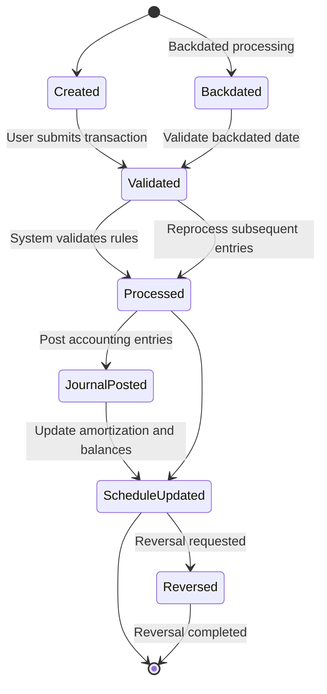

# EIR Calculation Phase 2 - Transaction Types

This page defines the transaction types available in the EIR Calculation for the Working Capital loan product, their business purpose, how they behave in the system, and the observable outcomes for operations staff, loan officers, branch managers, and credit agents. It describes how each transaction type interacts with the amortization schedule, accounting postings, validation rules, and backdating or reversal behavior. The content reflects verified product behavior and the publisher's standard operating practices.

### Overview and scope

The Working Capital product uses an Effective Interest Rate (EIR) based methodology to recognize income and to project amortization across the loan lifecycle. Transaction types are categorized as monetary and non-monetary. Monetary transactions alter balances and generate or adjust accounting entries; non-monetary transactions influence internal tracking and amortization bookkeeping without changing the loan balance. The system supports backdated processing and reprocessing, as well as reversal of transactions where allowed. All postings to the general ledger (GL) follow mappings defined at the loan product level. Transactions are presented in chronological order in the loan account activity view, and may be filtered or drilled into for deeper inspection of components (principal, fees, penalties).

Key roles benefit from clear, auditable behavior: operations staff apply and monitor transactions, loan officers and branch managers approve and disburse loans and adjustments, and credit agents review the impact of payments and refunds on customer accounts.

### Monetary vs non-monetary transaction types

- Monetary transactions are transactions that affect the loan balance or generate accounting entries directly. Examples include: Disbursement, Repayment, Discount Fees, Discount Fees Amortization (non-monetary), Credit Balance Refund (CBR), Payout Refund, Goodwill Credit, Recovery Payments (post write-off), and Payout Refund for fraud scenarios. Each monetary transaction follows a defined allocation rule (Penalties, Fees, Principal) and may trigger updates to the Amortization schedule and GL postings.
- Non-monetary transactions are system-generated or user-visible events that do not change the loan balance but are used for tracking amortization or adjustments. Examples include Discount Fees Amortization (non-monetary, tracking only) and Charge/Charge Adjustment () that affect downstream accounting through related entries.

For completeness, a broad set of related transaction types is defined and described in the sections that follow, including how they are processed, validated, and observed in the customer loan record.

---

### Detailed transaction types

#### 1) Disbursement

Purpose: Release of approved funds to the borrower, activating the loan account and initiating repayment obligations. Disbursement also creates or updates the Amortization schedule and increases the outstanding balance.

What happens in the system:
- The loan account is activated with the disbursed amount added to the principal balance.
- Charges configured as disbursement charges are applied automatically.
- An accounting entry is posted to reflect the disbursement and related charges.
- The Amortization schedule is created or updated to reflect the new exposure.

Validation and rules:
- Disbursement date must not precede the loan approval date.
- Amount must be greater than zero and must not exceed the approved amount for single disbursement.

Reversal handling:
- A reversal is allowed and creates a linked reversal transaction. It reverses all monetary impacts and accounting entries and reverts the loan to its pre-disbursement state.

Backdating:
- Backdated disbursements are supported subject to business date rules; processing will re-evaluate balances and the amortization plan.

Accounting:
- Journal entries are generated per the loan product’s GL mappings for the disbursement and any disbursement-time charges.

Observability:
- The activity appears in chronological order on the loan's transaction history with type “Disbursement,” amount, and any related charges.

---

#### 2) Repayment

Purpose: Represents a payment by the borrower toward the loan obligation. A repayment reduces the outstanding balance, updates the Amortization schedule, and triggers associated accounting entries. Repayment can be regular, partial, or an overpayment.

What happens in the system:
- The principal outstanding decreases by the repayment amount allocated to principal according to the configured allocation rules.
- The Amortization schedule is updated to reflect the new cash flow and remaining tenor.
- A Discount Fees Amortization transaction is created to reflect amortized deferred income if applicable.
- If the repayment results in an overpayment, a Credit Balance Refund (CBR) may be processed per policy and allocation rules.

Allocation and outcomes:
- Repayment amounts are allocated to components (Penalties, Fees, Principal) according to the defined priority order for the repayment transaction type or the loan product defaults.

Validation rules:
- Repayment date must not precede the loan disbursement date.
- Amount must be greater than zero.
- Repayments are allowed when the loan is Active, Closed, or Charged-Off subject to policy constraints.

Backdating and reprocessing:
- Backdated repayments trigger reprocessing of the Amortization schedule and replay of subsequent transactions and accounting entries.

Accounting:
- The repayment triggers standard accounting entries according to the loan product’s GL mappings and the allocation across principal, fees, and penalties.

Reversal handling:
- A repayment can be reversed. A linked reversal transaction is created and both the financial impact and accounting entries are reversed. The Amortization schedule is reprocessed .

Special scenarios:
- Overpayment handling results in a credit balance that can be refunded or applied to future installments.
- Post-charge-off repayments are treated as regular payments under charge-off accounting rules.
- Post-write-off repayments are treated as recovery income.

Observability:
- The loan activity view shows the repayment, its components, and any impact on the amortization schedule, including any amortization transaction created as part of the repayment.

---

#### 3) Discount Fees

Purpose: Represents the upfront income adjustment applied to a loan, generally at or after disbursement, and recognized over time via EIR-based amortization. It verifies income recognition follows cash flows and is reconciled with the amortization schedule.

Functionality:
- Discount fees are monetary transactions that create deferred income (discount fees) and adjust the effective yield (EIR).
- The total discount amount is amortized over the loan tenure and recognized as fee income progressively.
- The discount fee creates a deferred income balance and affects the EIR schedule. The actual accounting entries for the application and amortization are defined in the accounting specifications for this feature.
- The discount fee amortization is driven by repayments and by adjustments; it is system-generated on payment events and linked to the associated payment transactions.

Validation rules:
- Date must follows the disbursement date and the amount must be greater than zero.

Amortization logic (EIR-based):
- Amortization of discount fees follows the same EIR-based approach used for the overall loan, and is triggered on payment events. The portion of deferred income recognized as fee income on each repayment is determined by the recalculated schedule.

Accounting:
- Entries related to discount fees are posted at the time of the discount fee application and during amortization on repayments; the entries are defined in the product's accounting guidance.

Backdating and reprocessing:
- Because discount fees are anchored to the disbursement date, changing the amortization or payments may trigger a reprocessing of the EIR, amortization, and outstanding balances, and a replay of subsequent transactions.

Discount Fees Amortization (non-monetary):
- A distinct non-monetary transaction, Discount Fees Amortization, is generated automatically with payments to reflect the amortized component in the tracking system. It does not modify the loan balance and does not create GL entries.

Observability:
- The system shows a system-generated amortization record for discount fees linked to the associated payment, without changing the loan balance.

---

#### 4) Discount Fee Adjustment

Purpose: Adjustments to previously recognized or deferred discount fees, subject to strict controls and remaining balance eligibility.

Eligibility and constraints:
- Applicable to Working Capital loans in Active state with a non-reversed Discount Fee transaction available for adjustment.
- Adjustment amount must be greater than zero and cannot exceed the remaining adjustable discount balance.
- Adjustment date must be on or after the parent Discount Fee transaction date.
- Loan must be Active at the time of adjustment.

Process and effects:
1) The system creates a linked Discount Fee Adjustment transaction, linked to the parent Discount Fee via related resources.
2) The adjustment amount is recorded with a full allocation to the principal portion (matching the Discount Fee). A row is stored in the transaction allocation table.
3) The loan-level discount balance is reduced by the adjustment amount; principalOutstanding is recalculated from the disbursement plus updated discount.
4) The projected amortization schedule is regenerated to reflect the new discount and disbursement parameters, reapplying all recorded actual repayments from the previous model, and recalculating the EIR-based amortization, the NPV, and the deferred balance.
5) A business event is raised to reflect the adjustment.
6) Future discount fee amortization transactions are recalculated and posted using the updated EIR and amortization schedule.
7) The system reprocesses amortization, outstanding balances, and subsequent transactions as needed.

Validation rules:
- Amount > 0
- Amount <= remaining adjustable discount
- Transaction date >= parent Discount Fee date
- Loan status must be Active
- Parent transaction must be an Active Discount Fee

Special considerations:
- After prepayment, charge-off, or write-off events, any remaining unamortised discount fee may be recognized immediately or adjusted according to configuration rules.

Observability:
- The adjustment is visible as a linked transaction and affects subsequent amortization projections and balances.

---

#### 5) Prepayment

Purpose: allows a borrower to fully settle and close an active loan by paying the exact payoff amount as of a specified date. The system computes the payoff amount and disallows user edits to calculated amounts.

User input restrictions:
- Users cannot enter repayment allocations or modify any components (principal, interest, fees, penalties) or the payoff total.
- All payoff values are system-calculated and used as-is during processing.

Processing steps:
1) The system processes the payoff with calculated amounts and reduces the outstanding balance to zero.
2) Loan status transitions follow the product's closure rules.

Backdating:
- Backdated prepayments are supported, subject to business date rules and latest transaction dates.

Payoff recalculation:
- If the Payoff Date changes, the system recomputes the payoff amount and updates the displayed figures before submission.

Accounting:
- Prepayment uses the same accounting entries as a standard repayment transaction, reusing established repayment accounting mappings.

Observability:
- Prepayment appears as a close-out action in the loan's history with the payoff details and the final balance.

---

#### 6) Credit Balance Refund (CBR)

Purpose: Refund of excess funds when a loan is overpaid, to properly settle credit balances and reflect refunds in accounting.

Functionality:
- CBR is a monetary transaction executed on a loan with a credit balance (overpayment).
- It reduces the credit balance and updates loan balances .
- When an overpayment exists, the system may issue a refund to the customer or apply the overpayment to future dues according to rules.

Validation rules:
- CBR can be performed only if the loan has an available credit balance.
- The CBR amount must equal the full available credit balance (full refund).
- Transaction date must comply with business date rules and backdating rules.
- CBR is allowed for loans in standard overpaid states.

Reversal handling:
- CBR reversals are possible subject to validation. A linked reversal transaction is created, reversing both credit balance adjustments and related accounting entries.

Backdating and reprocessing:
- Backdated CBRs are supported, with validations such as not refunding before the smallest repayment date. Processing replays subsequent transactions and recalculates balances.

Accounting:
- CBR triggers journal entries per the loan product’s accounting mappings.

Balance and status behavior:
- If a repayment creates an overpayment, the status transitions to Active to Overpaid. After CBR, if the overpayment is resolved, the status may move toward Closed Obligations Met .

Observability:
- CBR appears in the loan activity with the refund amount and the post-refund balance status.

---

#### 7) Goodwill Credit

Purpose: A monetary adjustment provided to the borrower, typically to address service issues or operational corrections, reducing the outstanding balance as a goodwill gesture.

Functionality:
- Goodwill Credit is monetary and operates similarly to a repayment transaction. It reduces the outstanding balance and triggers amortization updates and related accounting entries.
- It can result in an overpayment if the goodwill credit exceeds the outstanding obligation.

Allocation and schedule impact:
- Allocation follows the repayment transaction type’s strategy or the loan product default.
- The system updates the amortization schedule and recalculates projected periods, including any discount amortization.

Validation rules:
- Goodwill Credit can be applied when the loan is Active, Charged-Off, or Closed.
- Amount must be greater than zero.

Accounting:
- Goodwill Credit triggers standard journal entries per the product’s GL mappings.

Reversal handling:
- Reversals create a linked reversal transaction and reverse allocation and accounting entries. The amortization schedule is reprocessed .

Overpayment handling:
- Excess funds may be refunded via a Credit Balance Refund transaction if applicable.

Special scenarios:
- Post Charge-Off repayments are treated as regular payments under charge-off rules; post Write-Off repayments are treated as recovery income.

Observability:
- The Goodwill Credit activity is visible in the loan’s transaction history with its components and effects on the schedule.

---

#### 8) Discount Fees Amortization (non-monetary)

Purpose: System-driven recognition of deferred income associated with discount fees for tracking purposes. This transaction type is informational and ties the repayment events to the amortization process without changing balances.

Functionality and behavior:
- This is a system-generated, non-monetary transaction created alongside payment events (repayments, goodwill credits, discount fee adjustments).
- It reduces the tracked deferred income in a reporting sense and creates an amortization record for audit and reporting, without impacting loan balances or GL accounts.

Validation rules:
- Discount Fees Amortization is system-generated only; it cannot be manually created, edited, or deleted independently.
- It triggers only when a valid payment transaction exists and there is a positive deferred income balance to amortize.

Processing and scheduling:
- On payment execution, the system computes the amortized portion of deferred income and creates a linked Discount Fees Amortization transaction. The transaction is processed in the same flow as the payment and remains traceable to the originating payment.
- Amortization is driven by the EIR methodology or by the product configuration for amortization; it updates the amortization record without affecting the loan's principal balance.

Accounting:
- No journal entries are generated by Discount Fees Amortization itself. It does not impact GL accounts or loan balances.

Backdating and reprocessing:
- If a backdated payment occurs, the system recalculates the amortization and reprocesses related entries and schedules as needed, replaying affected transactions.

Transactions linked to Discount Fees Amortization:
- Repayment, Discount Fee Adjustment, Goodwill Credit.

Reversal handling:
- Income amortization cannot be reversed independently. Reversal occurs when the parent transaction (repayment or goodwill credit) is reversed, and the amortization entry is recalculated or removed as part of the system’s reprocessing.

Special scenarios:
- If there is noDeferred Income available, no amortization transaction is generated.
- For multiple payments, an amortization transaction is generated for each payment.
- Prepayment or foreclosure leads to full amortization of remaining deferred income at the tracking level.

Restrictions:
- This is a system-generated dependent transaction; it cannot be manually created, edited, or deleted independently.

Observability:
- Amortization activity is visible in reporting as a tracking record tied to payments, not as a separate cash movement.

---

#### 9) Payout Refund (for WCP loans)

Purpose: A specialized transaction for recovering disbursed funds on a Working Capital loan account in fraud scenarios. It reduces the outstanding principal and fees/penalties per the allocation rule and posts a COB amortization transaction. If the refund exceeds the outstanding balance, the loan becomes Overpaid.

Functionality and processing:
- User enters the refund amount and selects a transaction date.
- The system validates eligibility and applies the refund to the loan according to the configured allocation rule (Penalties, Fees, Principal, UNC adjustments, etc.).
- The system posts journal entries per accounting mappings and updates the amortization schedule to reflect the COB amortization.
- If the refund exceeds the outstanding principal, the excess becomes an overpayment and causes the loan status to transition to Overpaid.

Backdating and reversal:
- Backdated Payout Refunds are allowed, subject to validations, and the system reprocesses the amortization and balances as of the target date.
- Reversals are supported: a linked reversal transaction reverses balance effects and accounting entries.

Accounting:
- The Payout Refund triggers standard GL postings per the loan product mappings.

Observability:
- The Payout Refund appears in the transaction history with its allocation details and its impact on the loan’s balance and status.

---

#### 10) Charge Transactions and Charge Adjustments

Charge Transaction (reviewed by comp owners):

Purpose: Represents the application of fees or penalties to a loan account when a charge is created or due.

Functionality:
- Charge transactions are system-generated when a charge is added at the disbursement level or when charges with specific due dates are configured.
- They increase the charge receivable and income, and adjust the amount to be collected under Fees or Penalties according to configuration.
- The charge transaction increases the loan balance under the charge portion (not principal).

Accounting:
- Entries are generated as of the transaction date, per the disbursement charge rules and the charge-specific accounting mappings.

Validation:
- Charge transaction is created only if the charge is configured and applied at the loan account level.

Charge Adjustment Transaction (reviewed by comp owners):

Purpose: Offsets charges that have already been paid, or adjusts to follows current accounting expectations.

Functionality:
- Charge adjustment behaves like a repayment-like movement but applies only to the fees, penalties, or principal components depending on the defined allocation priority.
- The adjustment cannot exceed the amount actually paid for the charge and must be greater than zero.

Processing and accounting:
- It results in the reduction of the collected charge amount and triggers associated accounting entries.
- On backdated execution, balances and charge components are recalculated and subsequent transactions replayed.

Reversals:
- Charge adjustments support reversals, producing a linked reversal transaction and reversing the charge impact and related accounting entries.

Observability:
- Charge transactions and adjustments appear in the loan’s chronological history with component breakdowns and reversal status.

---

#### 11) Charge-offs and Write-offs (summary)

Charge-off and related write-off scenarios are documented in the product requirements as part of the lifecycle handling for uncollectible balances. The charge-off process updates loan status to Charged-Off, writes off outstanding balances (principal, fees, penalties), and follows charge-off-specific accounting rules. Post-write-off recoveries are treated as recovery income, and the system supports post-charge-off repayment behavior under the charge-off rules. The details of the charge-off rhythm, policy constraints, and accounting mappings are defined in the Working Capital product requirements and the accounting specifications for charge-off scenarios.

---

### Transaction processing essentials (rules and observability)

- All monetary transactions update the loan’s opening and closing balances as part of the active lifecycle, and all such changes are reconciled with the Amortization schedule. The opening balance after every period must equal the previous period’s closing balance, verifying ledger integrity.
- Every monetary transaction triggers journal entries in accordance with the product’s GL mappings. The accounting entries reflect the components touched by the transaction (principal, fees, penalties) and update the loan’s ledgers.
- Non-monetary transactions (such as Discount Fees Amortization) exist to support amortization and reporting without impacting principal or GL balances; they are generated automatically by the system where standard and cannot be manually created, edited, or deleted independently.
- Backdated transactions are supported across eligible types and cause the system to reprocess the amortization schedule, re-calculate related amortization entries, and re-run affected transactions and journal postings.
- Reversals are supported for many transaction types. A reversal creates a linked reversal transaction that reverses both financial effects and accounting entries, and the system reprocesses the affected amortization and schedules.
- The user interface presents transactions in chronological order and provides filtering, drill-down, and linkage between original and reversal transactions for auditability.

---

### Operational steps: processing a representative repayment scenario (UI-oriented)

1) Open the customer loan account and go to the Transactions view.
 - Expected system outcome: the loan is in an Active state, with current balances displayed and the amortization schedule visible.
2) Choose the Transaction Type: **Repayment**.
 - Expected system outcome: a repayment entry form is presented with fields for Amount and Transaction Date and, if applicable, an allocation or payment reference.
3) Enter the repayment amount and the payment date, then submit.
 - Expected system outcome: the outstanding balance decreases by the amount allocated to principal, the amortization schedule updates to reflect the new cash flow, and a Discount Fees Amortization transaction is created to reflect amortization. If the repayment creates an overpayment, a credit balance is established and a subsequent CBR may be issued according to policy.
4) Review the transaction list to confirm: the repayment appears with its components, and any linked amortization or CBR entries are visible as standard.
 - Expected system outcome: all postings follows allocation rules and the amortization schedule reflects the latest cash flows.
5) If a backdated repayment is processed, the system reprocesses the amortization and replays subsequent transactions and accounting entries.
 - Expected system outcome: the historical transactions remain intact, while future periods reflect updated amortization projections.

Note: The actual UI control labels, exact field names, and permissible combinations are defined in the Working Capital product configuration and the loan product’s transaction-based accounting mappings. This page documents verified behavior and observable outcomes, not hypothetical UI strings.

---

### Diagram: transaction processing lifecycle (Mermaid)

This diagram illustrates a representative lifecycle: a transaction is created and validated, processed with journal entries, and then the amortization schedule and balances are updated. Reversals create a linked reversal transaction and trigger reprocessing of subsequent entries. Backdated transactions follow a similar flow with the system revalidating and reprocessing affected periods.

---

### Observability, reporting, and governance

- Transactions are presented in chronological order in the loan account's transaction history, with clear identification of each type, amount, and component breakdown (principal, fees, penalties). Reversal transactions are linked to their originals to support audit trails.
- The Amortization schedule is continuously updated as repayments, discounts, and adjustments occur. System-driven amortization entries (Discount Fees Amortization) are visible in reporting to reflect tracking of deferred income, without altering balances.
- Backdating and reprocessing are auditable events that cause re-computation of amortization and re-posting of relevant transactions and journal entries. Affected balances and future projections are clearly visible in loan-level reports.
- The Payout Refund, CBR, Goodwill Credit, and Discount Fee Adjustments each have their own path through allocation rules and GL postings, allowing traceability from customer action to accounting impact.

---

### Governance and references (conceptual only)

The behaviors described herein are derived from the verified product guidance for the Working Capital EIR calculation , including the defined transaction types, their accounting treatment, validation rules, backdating and reversal support, and the relationship to the amortization schedule. The information focuses on business behavior and observable outcomes, avoiding internal implementation details or confidential source material.