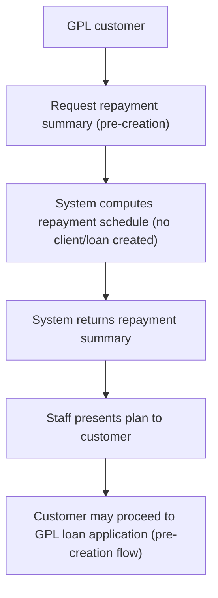

# Repayment Summary before loan creation

Repayment Summary before loan creation provides an API-driven capability to generate a repayment plan without creating a client or loan record. This feature allows staff and customers to view the proposed GPL loan repayment schedule prior to submitting a loan application. The summarized plan is intended solely for presentation to the customer and does not advance any client or loan creation through this API call. The capability follows existing behavior of generating a repayment schedule without creating client or loan records and supports verification of results across scenarios via API signals.

### Audience impact and business value

- Operations staff: can present a clear, pre-application repayment plan to customers, supporting informed decision-making.
- Loan officers and credit agents: obtain an early view of expected payments to inform guidance and counseling during the pre-application phase.
- Branch managers: verify consistency of repayment summaries with product terms and verify alignment with policy before proceeding to client creation.

### What the feature does

- allows an API call to generate a repayment summary before any client or loan is created.
- Returns a structured repayment plan suitable for customer presentation, reflecting the terms of the GPL loan product and the requested amount.
- Does not perform or imply any client creation or loan initiation as part of the API call.
- Supports verification across different scenarios; the results are derived from the GPL loan product terms and the requested principal amount.

### How results are produced and what you observe

- The system derives the repayment schedule from the GPL loan product terms and the requested principal amount. The resulting summary is intended for customer inspection prior to application.
- The response presents a repayment plan that can be used in the origination workflow to discuss affordability and expectations with the customer.
- If the customer proceeds, the standard pre-creation or loan-creation flow is used; at this stage, no client or loan is created by the repayment summary request.

### Operational procedure (API usage)

1. Prepare inputs per the API contract: provide the GPL loan product terms and the requested principal amount to the repayment summary API. The call does not create a client or loan.
2. Submit the request to the repayment summary API to generate the schedule prior to client/loan creation.
3. Receive the response containing the repayment summary. Confirm that the summary reflects the selected GPL product terms and the requested amount, and that no client or loan was created as a side effect of this call.
4. Present the repayment plan to the customer in the origination workflow. Use the schedule to illustrate monthly payments, total repayable, and schedule timing.
5. If the customer elects to proceed, continue with the established pre-creation or loan-creation process. The repayment summary itself does not instantiate client or loan records.

### Calculation approach and results presentation

The system performs a calculation to produce an amortization-based repayment schedule using the GPL loan product terms and the requested principal amount. The calculation method is aligned with standard amortization logic; installments consist of principal and interest components, and the sum of all installments equals the total amount repayable under the product terms.

 
Calculation

 
<strong>Formula:</strong> Amortization based on the GPL loan product terms; compute installment amounts with principal and interest components; total repayments equal the sum of all installments.

 
<strong>Inputs:</strong> GPL product terms and the requested principal amount.

 
<strong>Result:</strong> A repayment schedule with period dates, installment amounts, principal portions, interest portions, and the running balance after each payment.

### Data presentation and structure

The repayment summary is intended for customer-facing presentation. The schedule materializes as a sequence of payments over time, with each entry containing the period date, the total installment amount, the portion attributed to principal, the portion attributed to interest, and the remaining balance after the payment. The overall totals reconcile to the total amount repayable under the selected GPL product terms for the requested principal amount.

### Edge cases and considerations

- The API call does not create a client or a loan; it returns a standalone repayment schedule that can be shown to the customer during pre-application discussions.
- The schedule is generated based on the GPL product terms and the requested principal. If a scenario involves alternative term options or product variants, associated repayment summaries can be generated for each scenario as supported by the product capabilities.

### Diagram: repayment-summary pre-creation workflow

