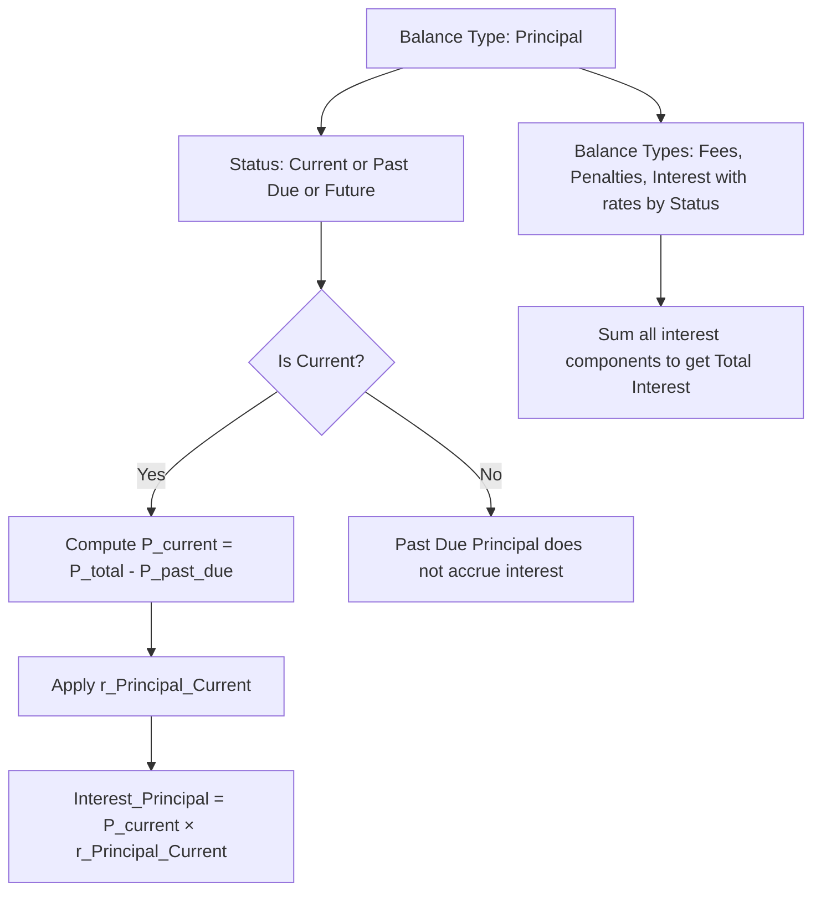

# Interest Rate by Balance Status and Past Due

### Overview
This feature provides configurable interest rates by balance status for each balance type on loan products. For every balance type—Fees, Penalties, Interest, and Principal—the system allows separate rates for Past Due, Current, and Future statuses. The intended effect is to vary how interest accrues based on the portion of a balance that is past due, current, or projected in the future. A key implementation detail is that interest should not be calculated on past-due principal amounts under the current rules. The configuration is applied at the loan product level and is currently limited to the Advance repayment strategy type.

### Scope and applicability
- Balance types with configurable rates: Fees, Penalties, Interest, Principal.
- Balance status categories for rate configuration: Past Due, Current, Future.
- Configuration level: Loan product level. The feature is currently limited to Advance repayment strategy type.
- Principal-specific rule: Interest should be calculated only on the Current Principal Balance, defined as total principal balance minus past-due principal balance. Past-due principal does not accrue interest under the current rules.
- Past due principal has a separately configurable rate, but that rate is not applied to interest accrual for current calculations unless future policy changes occur.

### Business rules and behavior
- Rate configuration exists for all balance types and all three statuses, enabling flexible policy definitions per product.
- For Principal, the calculation uses the Current Principal Balance for accrual in the Current status. The Past Due portion of Principal does not accrue interest under the current requirement.
- For Fees, Penalties, and Interest (the other balance types), interest accrues on the portions of those balances that are classified as Past Due, Current, or Future, using the rate configured for each associated status.
- Any balance portion with a zero value contributes zero to the interest calculation for its respective status.
- The system reports and stores the configured rates at the loan product level; changes apply to new loans created under the product and to existing loans when the product configuration is updated, as governed by product-level configuration rules.

### Calculation model (conceptual)
The system aggregates interest for a period by applying rate rules to the balance portions based on their status. The principal-specific rule is distinguished from the other balance types.

- Principal balances
 - Let P_total be the Total Principal Balance.
 - Let P_past_due be the Past Due Principal Balance.
 - Current Principal Balance, P_current = P_total - P_past_due.
 - Interest on Principal for the period is calculated using the rate configured for Principal at the Current status:
 - Interest_Principal = P_current × r_Principal_Current.
 - The Past Due Principal portion, P_past_due, does not accrue interest under the current rule set.
 - Note: A separate rate for Past Due Principal exists in configuration, but it is not applied to calculation today for the Principal balance under the current rule.

- Other balance types (Fees, Penalties, Interest)
 - Each balance type B has sub-balances partitioned by status (Past Due, Current, Future).
 - For each status s, the portion B_s accrues interest at the rate r_B_s configured for that balance type and status.
 - Total interest for the period is the sum of interest accrued across all balance types and statuses:
 - Interest_Total = Sum over B in {Fees, Penalties, Interest} and statuses s in {Past Due, Current, Future} of (B_s × r_B_s).
 - If any B_s is zero, its contribution to interest is zero.

> Note: The above calculations presume the system partitions each balance type’s amount by status and applies the associated rate per status. The principal calculation explicitly excludes Past Due Principal from accrual per current rules.

### Calculation representation (no numeric substitution)

 
Calculation

 
<strong>Formula:</strong> <code>Interest_Total = Interest_Principal + Interest_Fees + Interest_Penalties + Interest_Other</code>

 
<strong>Principal calculation:</strong> <code>P_current = P_total - P_past_due; Interest_Principal = P_current × r_Principal_Current</code>

 
<strong>Other balance types:</strong> <code>Interest_Fees = Σ (Fees_s × r_Fees_s) for s ∈ {Past Due, Current, Future}; similar for Penalties and Interest types</code>

 
<strong>Result:</strong> <code>Total interest accrued for the period based on configured rates and balance-status partitions</code>

 
Total Principal Balance (P_total)Value

 
Past Due Principal Balance (P_past_due)Value

 
Current Principal Balance (P_current)Derived: P_total - P_past_due

 
r_Principal_CurrentRate configured for Principal + Current status

 
r_Principal_PastDueRate configured for Past Due Principal

 
r_Fees_sRate configured for Fees by status s

 
r_Penalties_sRate configured for Penalties by status s

 
r_Interest_sRate configured for Interest by status s

### Operational procedures (UI navigation and steps)
Follow these steps to configure interest-rate-by-balance-status settings at the loan product level. Emphasized items indicate UI controls or outcomes.

1) Access the loan product:
- Open the product catalog and select the target loan product.
- From the product view, navigate to the following path and options:
 - **Interest and Accrual**
 - **Rates**
 - **Interest Rate by Balance Status and Past Due**
- The system presents the configurable grid for balance types and their status-specific rates.

2) Configure rates for each balance type:
- For each balance type, set rates for the three statuses. In particular:
 - Balance Type: **Principal**
 - Status: **Past Due** — set the rate for Past Due Principal (as a configuration option).
 - Status: **Current** — set the rate for Principal Current.
 - Status: **Future** — set the rate for Principal Future (if applicable).
 - Balance Types: **Fees**, **Penalties**, **Interest**
 - For each, set the rate for the three statuses: **Past Due**, **Current**, and **Future**.
- verify that for Principal, the calculation policy remains: interest is computed on the Current Principal Balance only. The Past Due Principal Rate is configured but not applied to accrual under the current rule.

3) Save and confirm:
- Click **Save** or **Apply Changes** to persist the configuration.
- The system should indicate that the configuration has been saved successfully and is active for new and existing loans governed by this product, subject to update policy rules.

4) Validate with a test scenario:
- Create or simulate a test loan under the product to observe accrual behavior.
- Verify that interest accrues on the Current Principal Balance (P_current) using the r_Principal_Current rate, and that Past Due Principal does not accrue interest.
- Verify that interest accrues on Fees, Penalties, and other Interest balances according to their respective status-based rates and balance amounts.

### Diagram: calculation flow

### Example structure (no numeric substitution)
To help operators inspect configuration and expected outcomes without exposing data, the following representation uses symbolic placeholders.

- Principal:
 - P_total: Total Principal Balance
 - P_past_due: Past Due Principal Balance
 - P_current: P_total - P_past_due
 - r_Principal_Current: Principal rate for Current balance
 - r_Principal_PastDue: Principal rate for Past Due balance (present for configuration but not applied today)
 - Interest_Principal = P_current × r_Principal_Current
- Fees, Penalties, Interest:
 - For each type T in {Fees, Penalties, Interest}
 - For each status s in {Past Due, Current, Future}
 - T_s: portion of balance T with status s
 - r_T_s: rate configured for type T and status s
 - Interest_T = Σ (T_s × r_T_s) over s

### Related notes and limitations
- The feature is currently limited to the Advance repayment strategy type.
- The Past Due Principal Rate is configurable but not used for accrual in the Principal calculation under the current rule set.
- The configuration applies at the loan product level, affecting all loans created under that product unless overridden by product policy.
- If future policy updates modify how Past Due Principal accrues, associated documentation will reflect new rules.

### Conclusion
This page documents the verified behavior: the system allows rate configuration by balance status for each balance type, with a principal-specific rule that accrues interest only on the current portion of principal, excluding past-due principal from accrual today. The configuration is accessible at the loan product level and is currently scoped to Advance repayment strategy type. Operators should follow the UI steps to configure rates, save changes, and validate accrual behavior against test scenarios to verify alignment with policy.