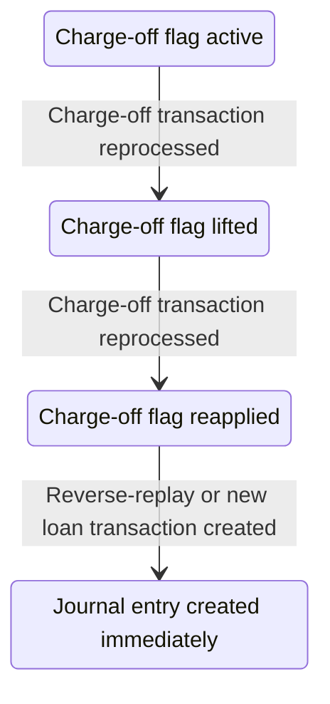
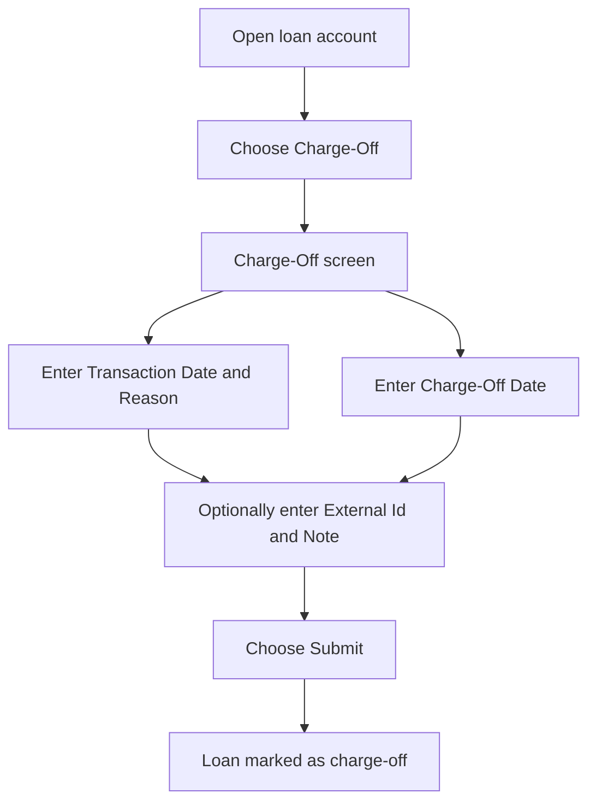

# Charge-Off

## Charge-Off

### Charge-off overview

Charge-off is an accounting treatment that marks a loan account as charged off without closing it or changing its balance. The account remains active and continues to work normally, with no impact on the loan portfolio or on data returned by existing APIs.

The following rules apply to charge-off marked loans:

- A new charge-off transaction is posted and the loan is marked as charge-off.
- The charge-off transaction is a dummy transaction that links to charge-off accounting entries and has no impact on the loan balance.
- All types of transactions are allowed on charge-off loans, and accounting entries differ for transactions on charge-off marked loan accounts.
- All actions, calculations, and transactions work normally on a charge-off marked loan account as on a non charge-off marked loan account.
- The loan stays ACTIVE unless its balance is cured.
- CHARGED_OFF status is never removed, even if the loan is PAID_OFF.
- The account can be altered even when the loan is marked for charge-off.

### Charge-off status and reversal

You can reverse a charge-off tag only when the charge-off was completed in error, as a remediation or exception process rather than normal business activity. Reversal is not supported if any transactions occurred after the charge-off transaction. A second charge-off on an already charged-off account returns a validation error, and the same restriction applies to undoing a charge-off. Once a loan is charged off, the charge-off status is never removed, even if the customer cures or settles their balance.

### Interest accrual

On interest-bearing loan accounts, interest accrual stops when the account is charged off. No interest calculation occurs beyond the charge-off date. Accrual resumes when the charge-off status is reversed, starting from the date accrual was previously stopped.

### Transaction rules and restrictions

A charge-off transaction can be backdated but not dated before the last transaction date. Once a loan is marked as charge-off, adding charges, rescheduling the loan, and restructuring installments are not allowed. Accounting entries remain the same for both cash based and accrual based accounting types.

The following restrictions apply to charge-off marked loan accounts:

- Reversal of transactions that happened before or on the date of the charge-off transaction is not allowed.
- Reversing a transaction before the charge-off either increases or decreases the charge-off amount during replay.
- A charge-off transaction can be reverse-replayed and the distribution must be maintained up to date.
- There are no fees or penalties for any charged-off loan, and no validations are added for this on the Fineract side.
- The amount marked as charge-off is the loan balance as of the current date.
- Adding a new charge on any date is not allowed once the loan is marked as charge-off.

The following transactions remain possible after charge-off:

- Chargeback, refunds, and other special case transactions are allowed, and the SOR does not restrict any transactions against the loan.
- CBR is allowed after charge-off, though very unlikely.

### GL mapping setup

A loan product includes new account mapping parameters for charge-off. Mapping these parameters to GL accounts is optional, but a loan account can use the charge-off feature only when the required GL mapping is in place.

### Charge-off events

When a charge-off happens for a loan account, the system raises a charge-off business event at the time the loan is marked to CHARGE-OFF. The event includes a transaction change event with the fees and charges array. The new charge-off transaction does not affect the loan balance and acts as a dummy transaction linking to charge-off accounting entries. The Loan API reports whether a loan is charged off using an is charged off true/false field.

### Undo charge-off details

You can undo a charge-off without providing any parameter. When you do, you may supply a reverse external ID, which the system stores on the transaction. You can later fetch that transaction by its external ID, which is not the reverse external ID.

### Pre-charge-off transaction handling

You can add or reverse transactions dated before the charge-off date, and those changes follow the standard accounting journal entry rules. Changes made after the charge-off date follow the charge-off accounting journal entry rules. Reversing the charge-off itself is not supported.

### Reverse replay challenges

Reverse replay creates journal entries in bulk at the end of the process, so the system cannot distinguish pre-charge-off entries from post-charge-off entries at the moment.

Possible strategies for creating journal entries are:

- Create GL entries one by one per transaction.
- Create GL entries in bulk for pre-charge-off transactions.
- Create GL entries in bulk for post-charge-off transactions.

### Charge-off transaction reprocessing

When you reverse or backdate a transaction dated before the charge-off date, the system reverses and replays the charge-off transaction to increase or decrease the charge-off amount, and balances change accordingly. The reversed charge-off transaction appears in the transaction response after you undo the charge-off.

The following rules apply to transactions around the charge-off date:

- You can reverse a transaction that happened before the charge-off date.
- You can add a transaction before the charge-off date.
- For reversal or backdated transactions dated before the charge-off date, the system follows standard accounting JE rules.
- Transaction changes happening after the charge-off date follow charge-off accounting JE rules.
- If a backdated transaction fully pays the loan, the charge-off transaction is reversed and the charge-off flag is lifted.

Closed or overpaid loans can be marked as fraud.

- Undo discount fee is not supported, but the option is available from the UI and currently shows an error.
- The undo discount button can be hidden from the UI.

### Charge-off accounting mappings

Charge-off accounting mappings define which general ledger accounts receive the interest and fees portions of a charge-off, depending on whether the charge-off is fraud-related or non-fraud-related. Charge adjustments and OCA repayments also map to specific accounts.

| Portion | Account mapping |
| --- | --- |
| Charge off Fraud Interest | Interest income charge off, Fee Receivable, charge-off interest income, Interest Receivable, charge-off interest income, Interest income charge off, Income |
| Charge off Fraud Fees | Fee Charge off, Fee Receivable, charge-off fees Income, Fees Receivable, charge-off fees Income, Fee Charge off, Income |
| Charge off Non Fraud Interest | Interest income charge off, Fee Receivable, charge-off interest income, Interest Receivable |
| Charge off Non Fraud Fees | Fee Charge off, Fee Receivable, charge-off fees Income, Fees Receivable |
| Charge adjustment Fees | Fee Income, Fee Charge off, income from fees, charge-off fees Income |
| OCA Repayment Interest | Other receivables, recoveries, fund source /advance accounting, Income from Recovery payment |
| OCA Repayment Fees | Other receivables, recoveries, fund source /advance accounting, Income from Recovery payment |

### Transaction accounting entries

Transaction refunds and provisional credits post debit and credit entries to general ledger accounts based on the transaction type, cash direction, reversal indicator, and charged-off flag. The debit account is always 145023 for cash-in entries and never 145023 for cash-out entries.

| Transaction | Cash direction | Reversal indicator | Charged off flag | Debit account | Credit account |
| --- | --- | --- | --- | --- | --- |
| Loan Disbursement Principal Cash Out | Cash Out |  |  | 112601 | 145023 |
| Transaction Refund/Provisional Credit Interest - Repayment Cash In | Cash In |  |  | 145023 | 112603 |
| Transaction Refund/Provisional Credit Late Fee Payment Cash In | Cash In |  |  | 145023 | 112603 |
| Transaction Refund/Provisional Credit NSF Fee Payment Cash In | Cash In |  |  | 145023 | 112603 |
| Transaction Refund/Provisional Credit Snooze Fee Payment Cash In | Cash In |  |  | 145023 | 112603 |
| Transaction Refund/Provisional Credit Principal Payment Cash In | Cash In |  |  | 145023 | 112601 |
| Transaction Refund/Provisional Credit Unallocated Credit (UNC) Cash In | Cash In |  |  | 145023 | 245000 |
| Transaction Refund/Provisional Credit Interest - Repayment Cash In | Cash In |  | Y | 145023 | 404001 |
| Transaction Refund/Provisional Credit Late Fee Payment Cash In | Cash In |  | Y | 145023 | 404008 |
| Transaction Refund/Provisional Credit NSF Fee Payment Cash In | Cash In |  | Y | 145023 | 404008 |
| Transaction Refund/Provisional Credit Snooze Fee Payment Cash In | Cash In |  | Y | 145023 | 404008 |
| Transaction Refund/Provisional Credit Principal Payment Cash In | Cash In |  | Y | 145023 | 744007/740037 |
| Transaction Refund/Provisional Credit Unallocated Credit (UNC) Cash In | Cash In |  | Y | 145023 | 245000 |
| Transaction Refund/Provisional Credit Interest - Repayment Cash Out | Cash Out | Y |  | 112603 | 145023 |
| Transaction Refund/Provisional Credit Late Fee Payment Cash Out | Cash Out | Y |  | 112603 | 145023 |
| Transaction Refund/Provisional Credit NSF Fee Payment Cash Out | Cash Out | Y |  | 112603 | 145023 |
| Transaction Refund/Provisional Credit Snooze Fee Payment Cash Out | Cash Out | Y |  | 112603 | 145023 |
| Transaction Refund/Provisional Credit Principal Payment Cash Out | Cash Out | Y |  | 112601 | 145023 |
| Transaction Refund/Provisional Credit Unallocated Credit (UNC) Cash Out | Cash Out | Y |  | 245000 | 145023 |
| Transaction Refund/Provisional Credit Interest - Repayment Cash Out | Cash Out | Y | Y | 404001 | 145023 |
| Transaction Refund/Provisional Credit Late Fee Payment Cash Out | Cash Out | Y | Y | 404008 | 145023 |
| Transaction Refund/Provisional Credit NSF Fee Payment Cash Out | Cash Out | Y | Y | 404008 | 145023 |
| Transaction Refund/Provisional Credit Snooze Fee Payment Cash Out | Cash Out | Y | Y | 404008 | 145023 |
| Transaction Refund/Provisional Credit Principal Payment Cash Out | Cash Out | Y | Y | 744007/740037 | 145023 |
| Transaction Refund/Provisional Credit Unallocated Credit (UNC) Cash Out | Cash Out | Y | Y | 245000 | 145023 |

### Good will accounting entries

Good will accounting entries post when a repayment is made without cash, and the debit and credit accounts depend on whether the loan carries the charged off flag.

| Transaction | Debit account | Credit account |
| --- | --- | --- |
| Good Will Interest - Repayment No Cash | 404001 | 112603 |
| Good Will Late Fee Payment No Cash | 744003 | 112603 |
| Good Will NSF Fee Payment No Cash | 744003 | 112603 |
| Good Will Snooze Fee Payment No Cash | 744003 | 112603 |
| Good Will Principal Payment No Cash | 744003 | 112601 |
| Good Will Unallocated Credit (UNC) No Cash | 744003 | 245000 |
| Good Will Interest - Repayment No Cash with Charged off Flag Y | 404001 | 744008 |
| Good Will Late Fee Payment No Cash with Charged off Flag Y | 744003 | 744008 |
| Good Will NSF Fee Payment No Cash with Charged off Flag Y | 744003 | 744008 |
| Good Will Snooze Fee Payment No Cash with Charged off Flag Y | 744003 | 744008 |

### Waiver accounting entries

Waiver accounting entries record how late fee and NSF fee waivers affect the general ledger when no cash changes hands. The debit and credit accounts depend on whether the entry reverses a waiver and whether the loan is charged off.

| Transaction type | Conditions | Debit account | Credit account |
| --- | --- | --- | --- |
| Late Fee Waiver Late Fee Payment No Cash | None | 404007 | 112603 |
| Late Fee Waiver Late Fee Payment No Cash | Charged off Flag Y | 404007 | 404008 |
| Late Fee Waiver Late Fee Payment No Cash | Reversal Indicator Y | 112603 | 404007 |
| Late Fee Waiver Late Fee Payment No Cash | Reversal Indicator Y and Charged off Flag Y | 404008 | 404007 |
| NSF Fee Waiver NSF Fee Payment No Cash | None | 404007 | 112603 |
| NSF Fee Waiver NSF Fee Payment No Cash | Charged off Flag Y | 404007 | 404008 |
| NSF Fee Waiver NSF Fee Payment No Cash | Reversal Indicator Y | 112603 | 404007 |
| NSF Fee Waiver NSF Fee Payment No Cash | Reversal Indicator Y and Charged off Flag Y | 404008 | 404007 |

### Auto payment accounting entries

Auto payment accounting entries record how each payment type moves cash between GL accounts.

| Payment type | Cash in debit | Cash in credit | Cash out debit | Cash out credit |
| --- | --- | --- | --- | --- |
| Late Fee Payment | 145023 | 744008 | 744008 | 145023 |
| NSF Fee Payment | 145023 | 744008 | 744008 | 145023 |
| Snooze Fee Payment | 145023 | 744008 | 744008 | 145023 |
| Principal Payment | 145023 | 744008 | 744008 | 145023 |
| Unallocated Credit (UNC) | 145023 | 245000 | 245000 | 145023 |

### Scheduled payment accounting entries

Scheduled payment accounting entries record cash movements for late fee, NSF fee, snooze fee, principal, and unallocated credit payments. Each entry posts a debit or credit to account 145023 with the matching offset account.

| Payment type | Cash direction | Debit account | Credit account |
| --- | --- | --- | --- |
| Late Fee Payment | Cash in | 145023 | 112603 |
| NSF Fee Payment | Cash in | 145023 | 112603 |
| Snooze Fee Payment | Cash in | 145023 | 112603 |
| Principal Payment | Cash in | 145023 | 112601 |
| Unallocated Credit (UNC) | Cash in | 145023 | 245000 |
| Late Fee Payment | Cash out | 112603 | 145023 |
| NSF Fee Payment | Cash out | 112603 | 145023 |
| Principal Payment | Cash out | 112601 | 145023 |
| Unallocated Credit (UNC) | Cash out | 245000 | 145023 |

| Payment type | Cash direction | Debit account | Credit account |
| --- | --- | --- | --- |
| Late Fee Payment | Cash in | 145023 | 744008 |
| NSF Fee Payment | Cash in | 145023 | 744008 |
| Snooze Fee Payment | Cash in | 145023 | 744008 |
| Principal Payment | Cash in | 145023 | 744008 |

The system also applies fee returns for late fee payments with no cash, referencing R289 or R290 depending on the configuration.

### Charge-off portion mappings

Charge-off portion mappings determine how each loan amount moves between accounts when a charge-off, charge adjustment, or OCA repayment is processed.

| Portion | From account | To account | Income references |
| --- | --- | --- | --- |
| Charge-off Fraud Interest | Interest income charge off | Interest Receivable | Charge-off interest income on both sides |
| Charge-off Fraud Fees | Fee Charge off | Fee Receivable | Charge-off fees income on both sides |
| Charge-off Fraud Penalty | Fee Charge off | Fee Receivable | Charge-off penalty income |
| Charge-off Non Fraud Interest | Interest income charge off | Interest Receivable | Charge-off interest income on both sides |
| Charge-off Non Fraud Fees | Fee Charge off | Fee Receivable | Charge-off fees income on both sides |
| Charge-off Non Fraud Penalty | Fee Charge off | Fee Receivable | Charge-off penalty income |
| Charge adjustment Fees | Fee Income | Fee Charge off | Income from fees and charge-off fees income referencing R25 |
| Charge adjustment Unallocated Credit (UNC) | Fee Income | Other Credit liability | Income from fees and overpayment liability |
| Charge adjustment Penalty | Fee Income | Fee Charge off | Income from penalties and charge-off penalty income |
| OCA Repayment Interest | Other receivables | Recoveries | Fund source / advance accounting and income from recovery payment |
| OCA Repayment Fees | Other receivables | Recoveries | Fund source / advance accounting and income from recovery payment |
| OCA Repayment Unallocated Credit (UNC) | Other receivables | Other Credit liability | Fund source / advance accounting and overpayment liability |
| OCA Repayment Penalty | Other receivables | Recoveries | Fund source / advance accounting and income from recovery payment |

### GL account definitions

| GL account | Name | Type |
| --- | --- | --- |
| 112601 | Loans Receivable | Asset |
| 145023 | Suspense/Clearing account | Suspense/clearing account |
| 112603 | Fee Receivable | Asset |
| 245000 | Other Credit liability | Liability |
| 744003 | Principal bal adjustment | Expense |
| 404001 | Interest income charge off | Income |
| 404007 | Fee Income | Income |
| 404011 | Fee Income | Income |
| 404000 | Interest income | Income |
| 145800 | Other receivables | Asset |

### Duplicate transaction entries

The system does not reverse and replay a charge off when a payment occurs after the charge off.

| Transaction | Debit account | Credit account |
| --- | --- | --- |
| Loan Disbursement Principal Cash Out | 112601 | 145023 |
| Transaction Refund/Provisional Credit Late Fee Payment Cash in | 145023 | 112603 |
| Transaction Refund/Provisional Credit NSF Fee Payment Cash in | 145023 | 112603 |
| Transaction Refund/Provisional Credit Snooze Fee Payment Cash in | 145023 | 112603 |
| Transaction Refund/Provisional Credit Principal Payment Cash in | 145023 | 112601 |
| Transaction Refund/Provisional Credit Unallocated Credit (UNC) Cash in | 145023 | 245000 |
| Transaction Refund/Provisional Credit Late Fee Payment Cash in with Y | 145023 | 404008 |
| Transaction Refund/Provisional Credit NSF Fee Payment Cash in with Y | 145023 | 404008 |
| Transaction Refund/Provisional Credit Snooze Fee Payment Cash in with Y | 145023 | 404008 |
| Transaction Refund/Provisional Credit Principal Payment Cash in with Y | 145023 | 744007/740037 |
| Transaction Refund/Provisional Credit Unallocated Credit (UNC) Cash in with Y | 145023 | 245000 |
| Transaction Refund/Provisional Credit Late Fee Payment Cash Out with Y | 112603 | 145023 |
| Transaction Refund/Provisional Credit NSF Fee Payment Cash Out with Y | 112603 | 145023 |
| Transaction Refund/Provisional Credit Snooze Fee Payment Cash Out with Y | 112603 | 145023 |

### Simplified charge-off portion mappings

Charge-off portion mappings determine which general ledger accounts receive each charge-off portion, depending on whether the loan is classified as fraud or non-fraud and whether the entry is a charge-off portion, a charge adjustment, or an OCA repayment.

| Portion | Fraud mapping | Non-fraud mapping |
| --- | --- | --- |
| Interest | Interest income charge off, Interest Receivable | Interest income charge off, Interest Receivable |
| Fees | Fee Charge off, Fee Receivable, charge-off fees Income, Fees Receivable | Fee Charge off, Fee Receivable, charge-off fees Income, Fees Receivable |
| Penalty | Fee Charge off, Fee Receivable, charge-off Penalty Income, Penalty Receivable | Fee Charge off, Fee Receivable, charge-off Penalty Income, Penalty Receivable |

| Portion | Charge adjustment mapping | OCA Repayment mapping |
| --- | --- | --- |
| Interest | Fee Income, Fee Charge off, income from fees, charge-off fees Income | Other receivables, recoveries, fund source /advance accounting, Income from Recovery payment |
| Unallocated Credit (UNC) | Fee Income, Other Credit liability, income from fees, Overpayment Liability | Other receivables, Other Credit liability, fund source /advance accounting, Overpayment Liability |
| Penalty | Fee Income, Fee Charge off, income from penalties, charge-off Penalty Income | Other receivables, recoveries, fund source /advance accounting, Income from Recovery payment |

### Debit credit charge-off mappings

Charge-off debit and credit mappings depend on whether the loan is classified as fraud or non-fraud and on whether the entry is a charge-off or a charge adjustment.

| Charge-off type | Portion | Debit | Credit |
| --- | --- | --- | --- |
| Fraud | Interest | Interest income charge off | Interest Receivable |
| Fraud | Fees | Fee Charge off | Fee Receivable |
| Fraud | Penalty | Fee Charge off | Penalty Receivable |
| Non Fraud | Interest | Interest income charge off | Interest Receivable |
| Non Fraud | Fees | Fee Charge off | Fee Receivable |
| Non Fraud | Penalty | Fee Charge off | Penalty Receivable |
| Charge adjustment | Fees | Fee Income | Fee Charge off |
| Charge adjustment | Penalty | Fee Income | Fee Charge off |

### Charge-off GL types

Charge-off GL types assign each charge-off amount to a general ledger account and a GL type. Charge-off also charges off origination fees and stops amortization after the charge-off date.

| Charge-off amount | Maps to | GL type |
| --- | --- | --- |
| Charge-off expense | Credit Loss/Bad Debt | Expense |
| Charge-off expense - fraud | Credit Loss/Bad Debt Fraud | Expense |
| Charge-off interest income | Interest income charge off | Income |
| Charge-off fees income | Fee Charge off | Income |
| Charge-off penalty income | Fee Charge off | Income |

| Good will credit amount | Maps to | GL type |
| --- | --- | --- |
| Good will credit interest income | GL 404001 | Income |
| Good will credit fees income | GL 404008 | Income |
| Good will credit penalties income | GL 404008 | Income |

### UI fields and buttons

The charge-off screen lets you record a charge-off date and reason for a loan. The Charge-off button appears on the Loan details page, alongside the Undo charge-off button, which shows only when an active charge-off exists. New GL mapping fields for charge-off are introduced in loan product Accounting mapping, and the existing parameter name goodwill credit in expense category is renamed to Expenses from goodwill credit.

The charge-off screen includes the following fields and buttons:

- Transaction Date is required.
- Charge-Off Date is required.
- Reason for Charge-Off is required.
- The screen supports transaction date, note, locale, date format, charge-off reason ID, and external ID.
- Charge-Off Amount appears on the screen.
- Cancel and Submit buttons are available.

The charge-off amount message behaves as follows:

- When submitted-date based accrual accounting is turned on, the submitted on date appears on the charges tab and is properly filled.
- When submitted-date based accrual accounting is off, the charges page tab remains as is.

### Journal entry timing

Journal entries for charge-off transactions are created in bulk at the end of the workflow rather than immediately when a transaction is created or reverse-replayed.

### Charge-off procedure

You charge off a loan account from its actions menu. The charge-off screen records the charge-off date and reason, with optional external ID and note fields. The loan API also marks an account as charged off and reports whether it is charged off.

1. Open the loan account and choose "Charge-Off" from the actions.
2. Enter the Charge-Off Date.
3. Optionally enter Reason for Charge-Off, External Id and Note.
4. Choose Submit.

### Worked examples

A loan officer disburses a loan of 1,000.00 with no interest for simplicity. When the outstanding balance is 1,000.00, the officer marks the loan as charge-off. The figures in this example are illustrative. The system posts a dummy charge-off transaction for 1,000.00, which equals the loan balance as of that date. The loan balance does not change, the loan remains active, and the charge-off flag is turned on. There is no impact on the loan portfolio. The charge-off amount stays fixed even if the customer pays afterward.

| Step | Transaction | Amount | Loan balance | Charge-off amount | Loan status |
| --- | --- | --- | --- | --- | --- |
| 1 | Disburse loan | 1,000.00 | 1,000.00 | 0.00 | Active |
| 2 | Mark charge-off | 1,000.00 | 1,000.00 | 1,000.00 | Active (charge-off on) |
| 3 | Receive payment | 200.00 | 800.00 | 1,000.00 | Active (charge-off on) |

A loan with a balance of 1,000.00 is marked charge-off. The customer then repays 400.00 through one of the available payment channels—scheduled, real-time, or auto-pay. All transaction types remain allowed on charge-off loans, so the repayment is accepted. The loan balance falls to 600.00, while the charge-off amount stays fixed at 1,000.00. The accounting entries use the charge-off mapping rather than the standard mapping. The only difference between channels is the transaction source label; the balance and charge-off amount are identical.

| Payment channel | Repayment | Loan balance after repayment | Charge-off amount |
| --- | --- | --- | --- |
| Scheduled | 400.00 | 600.00 | 1,000.00 |
| Real-time | 400.00 | 600.00 | 1,000.00 |
| Auto-pay | 400.00 | 600.00 | 1,000.00 |

A loan of 1,000.00 is outstanding. The customer repays 300.00 before the charge-off date, reducing the balance to 700.00. On the charge-off date, the officer marks the loan charge-off and the charge-off amount is set to 700.00. Later, the officer reverses the 300.00 repayment because it was posted in error. Since the reversal dates before the charge-off, the balance before charge-off rises back to 1,000.00 and the charge-off amount is replayed to 1,000.00.

| Step | Date | Event | Balance before charge-off | Charge-off amount |
| --- | --- | --- | --- | --- |
| 1 | 1-Jan | Disburse loan | 1,000.00 | 0.00 |
| 2 | 1-Mar | Repay 300.00 | 700.00 | 0.00 |
| 3 | 1-Jun | Mark charge-off | 700.00 | 700.00 |
| 4 | 10-Jun | Reverse the 1-Mar repayment | 1,000.00 | 1,000.00 |

A loan is marked charge-off in error while its balance is 1,000.00 and interest accrual has stopped. An administrator undoes the charge-off as a remediation, not as normal business. The charge-off tag is reversed to non-charge-off, interest accrual resumes from the date it was stopped, and the reversed charge-off transaction remains visible in the transaction history. If the user supplies an external id, it is stored on the reversal transaction.

| Step | Action | Charge-off flag | Interest accrual | Reversed charge-off visible |
| --- | --- | --- | --- | --- |
| 1 | Mark loan charge-off | On | Stopped | – |
| 2 | Undo charge-off | Off | Resumes from stop date | Yes |

See also: [Payment Allocation Strategies: Payment Allocation Strategies](../repayments/allocation-strategies.md#payment-allocation-strategies).
