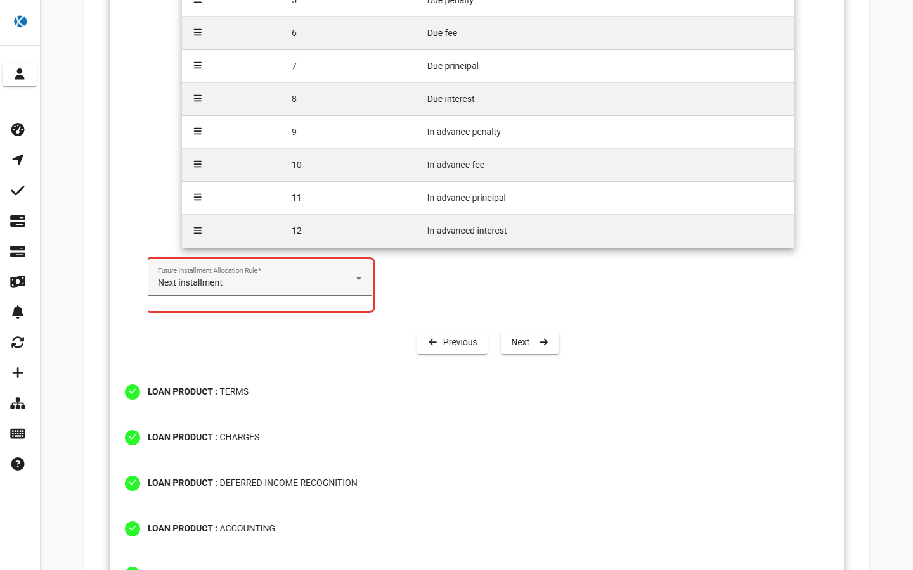
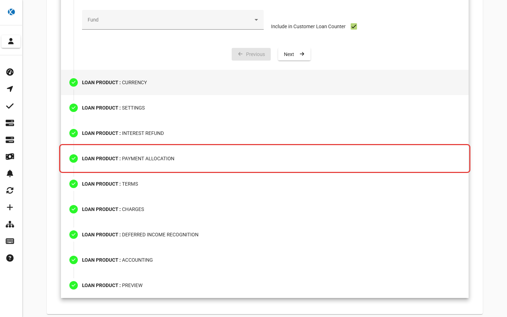

# Configurable Payment Allocations

## About configurable payment allocations

Configurable payment allocations let you set how payments are applied by transaction type for each loan product. You can configure allocations for Repayment, Goodwill credit, payout refund, Merchant refund, Charge Adjustments, and Downpayment. The same allocation applies to every sub-payment type within a transaction type. Each loan product can have its own advanced payment allocation configuration.

## Configure advanced payment allocation

Use this screen to set the order in which payments are allocated across installments and balances for a loan product with Advanced payment allocation selected.

1. Select **Admin** > **Products** > **Loan Products**.
2. Select **Create** > **Create Loan Product (Classic)**, or open an existing product and select **Edit**.
3. Open the **PAYMENT ALLOCATION** step.

   

| Field | Required | Description |
| --- | --- | --- |
| Credit Allocation Strategy | No | Set the credit allocation strategy for the selected transaction type. |
| Future Installment Allocation Rule | No | Choose how future installments are allocated: Next installment (default), Last installment, or Re-amortization. |

Payments are allocated across installments and outstanding balances in the order you set.

## Advanced payment allocation strategy

Advanced payment allocation lets you control how payments are applied to installments and charges. Select “Advanced payment allocation” as the repayment strategy to open the “Payment allocation” tab and set the default payment allocation order.

Required settings:

- Set the default payment allocation rule for the default transaction type with all 12 valid values.
- Set the future installment allocation rule to a valid value.
- Set a default payment allocation order.

Future installment allocation rule options:

| Code | Description |
| --- | --- |
| NEXT_INSTALLMENT | Next installment (default) |
| LAST_INSTALLMENT | Last installment |
| REAMORTIZATION | Re-amortization |

Installment processing strategy:

- The installment processing strategy has two values: HORIZONTAL (default) and VERTICAL.

Strategy code:

| Code | Order |
| --- | --- |
| advanced-payment-allocation-strategy | 8 |

## Eligibility and disbursement handling

Advanced payment allocation is supported only for Progressive loan disbursement handling.

## Payment allocation tab and UI

The Payment allocation tab lets you choose a transaction type and set its payment allocation order. The Default transaction type is selected by default.

You can select one of these transaction types:

- Repayment
- Down payment
- Merchant issues refund
- Payout refund
- Goodwill credit
- Charge refund
- Charge adjustment
- Refund for active loans
- Interest waiver

The tab also includes a dropdown for selecting the future installment allocation rule.

## Default allocation rules

Default allocation rules decide how a repayment is spread across installments when no rule is set for a specific transaction type. The DEFAULT transaction type always exists and acts as the fallback.

Rules for default allocation:

- When a default allocation rule is set, payment transactions are allocated in the order it was set across the installments.
- A default allocation can be overruled by configuring a payment allocation order for a specific transaction type.

## Transaction types for allocation

For loans with Advanced payment allocation configured, Refund for active loan is also available as a transaction type with its own allocation order.

## Main allocation categories and rules

The main allocation order decides how the system distributes a transaction amount across repayment schedules and outstanding balances. The categories are past due, due, and in advance installments, and the balances are principal, penalty, fee, and interest.

Main allocation rules:

- Past due installments are always allocated from the oldest installment.
- Due installments are allocated only to the current due installment when the transaction date is the same as the due date.
- Future installments can be allocated from the next installment, from the last installment, or re-amortized to future installments; re-amortization applies only to the principal portion of installments.

## Secondary allocation categories and rules

Secondary allocation categories are PENALTY, FEE, PRINCIPAL, and INTEREST. The secondary allocation rule options are T3.R1 Penalties, T3.R2 Fees, T3.R3 Principal, and T3.R4 Interest.

## Future installment allocation options

For future installments, you choose how an in advance allocation is applied: to the next due installment first, to the last due installment first, or divided evenly across all future installments.

| Option | How in advance allocation is applied |
| --- | --- |
| Next installment | To the next due installment first based on due date, then to subsequent due installments if the transaction amount remains. |
| Last installment | To the last installment by due date first, then to the last but one installment if the transaction amount remains. |
| Reamortization | Divided into equal amounts between the future installments. |

## Horizontal and vertical processing

Horizontal processing applies allocation rules in installment scope, processing installments from oldest to latest one by one. Vertical processing applies allocation rules in repayment schedule scope, processing balances one by one based on whether they are past due, due or in advance.

Rules and limits:

- When HORIZONTAL processing is configured, allocation rules must be grouped by due type.
- With VERTICAL processing, the grouping restriction does not apply.

> **Note:** For a past due installment not fully paid under horizontal processing, allocation pays unpaid penalty first, then unpaid fee, then unpaid interest, then unpaid principal.

## Transaction and charge ordering

The system orders loan transactions by transaction date, then submitted on date, then created date time. It orders loan charges by due date, then submitted on date, then creation date time. For loans with Advanced payment allocation configured, transactions and charges are ordered and processed in chronological order comparing charge due date versus transaction date, then submitted on date, then creation date time.

## Reverse replay and reprocessing

Reverse replay and reprocessing apply to loans with Advanced payment allocation configured. Reprocessing happens only when a backdated transaction or backdated charge is added and something changes that requires this side-effect. Prior payment transactions are not affected by later added charges.

Reprocessing is unnecessary in these cases:

- A repayment is on or after the prior last processed transaction.
- A charge is added with a due date after the last processed transaction.
- A backdated transaction or charge is last in chronological order.
- A charge is added with a due date after a backdated repayment.
- A chargeback is processed.
- A write-off is undone.
- A loan is closed.
- A refund is made for an active loan.
- A refund is the last transaction.

Reprocessing is required when:

- A loan charge due date is earlier than the last transaction date.
- Transactions are reprocessed and the repayment schedule is rebuilt from the ground up.
- Disbursement transactions are reprocessed and added again to the installment.
- Interest handling might result in different interest.

Behaviour during reverse replay:

- Only transactions with dates later than a newly added transaction can be reallocated.
- An installment paid in advance is not revert-replayed after disbursement.
- Adding a charge later than a repayment does not require reprocessing the repayment.
- Prior repayments are not reverse-replayed when a charge is added.

Charge handling:

- Loan charges can be configured whether they participate in reverse-replaying or not.
- By default, loan charges are not reverse-replayed.
- Only newly added payment transactions consider repaying newly added charges based on the repayment strategy.
- A loan charge can be reverse-replayed when advanced repayment allocation strategy is set.
- Charge off transaction kicks in only when a change modifies the outstanding balance.
- Removing or updating a charge is not allowed after approve.

## Write-off and charge-off

For loans with Advanced payment allocation configured, a write-off transaction sets the loan balance to 0, closes the loan, and writes off all outstanding amounts. You cannot reverse a payment made before the write-off. A charge-off transaction matches all outstanding balances and is processed the same as before, with minimal changes to existing charge-off logic.

## Refunds and credit balance refunds

A refund is a transaction type for loans with Advanced payment allocation configured. It works opposite to a repayment and can have its own allocation order. A credit balance refund calculates the balance and covers only that balance.

Allocation rules decide how a refund is applied:

- A refund applies to any past due installments first, and the remaining credit balance is reamortized across future due installments.
- A refund applies to the next installment.
- A refund applies to the past due amount for installment 2 and the next installment (installment 3).
- A refund applies to the past due installment 1, and then to next installments 2, 3, then 4.
- When nothing is past due or due, a refund applies to the final installments.
- A refund applies to the next installment (installments 2 and 3).
- A refund applies to the past due amount for installment 2 and next installment (installments 3).
- A refund applies to the past due (installment 1), and next installments (installments 2, 3 then 4).
- Refund applied to due/past due/delinquent amounts (oldest) first, and remainder of any refund applies to the final installment.
- Refund applied to any past due amount and then due amount.

## Chargeback

For loans with Advanced payment allocation configured, when you add a chargeback after maturity, the system creates an additional installment. The chargeback is allocated proportionally according to what the original payment paid off.

## Re-amortization

Re-amortization recalculates remaining installments after a payment. If an N+1 installment exists, it is included in the recalculation. When the re-amortization amount overpays the principal portion of all installments, the excess allocates to other portions according to the secondary allocation set, such as unpaid penalty or fees.

## Loan product configuration and inheritance

When you select the Advanced payment allocation repayment strategy for a loan product, each new loan account created under that product copies the product's configured payment allocation rules. Changes to a loan product's allocation rules apply only to new loan accounts; existing loans keep the rules they inherited when they were created. You can customize allocation priority per loan product and at transaction type level.

The default allocation order is:

| Position | Category | Code |
| --- | --- | --- |
| First | Fees | 263 |
| Second | Penalty | 69 |
| Third | Interest | 500 |
| Fourth | Principal | 465 |

The UI provides these allocation rule codes:

- PAST_DUE_PENALTY
- PAST_DUE_FEE
- PAST_DUE_PRINCIPAL
- PAST_DUE_INTEREST
- DUE_PENALTY
- DUE_FEE
- DUE_PRINCIPAL
- DUE_INTEREST
- IN_ADVANCE_PENALTY
- IN_ADVANCE_FEE
- IN_ADVANCE_PRINCIPAL
- IN_ADVANCE_INTEREST

## Allocation rule codes

Allocation rule codes tell the system which part of a payment to apply to each loan component. Each code names a component and a timing: due, past due, or in advance.

| Timing | Penalty | Fee | Principal | Interest |
| --- | --- | --- | --- | --- |
| Due | DUE_PENALTY | DUE_FEE | DUE_PRINCIPAL | DUE_INTEREST |
| Past due | PAST_DUE_PENALTY | PAST_DUE_FEE | PAST_DUE_PRINCIPAL | PAST_DUE_INTEREST |
| In advance | IN_ADVANCE_PENALTY | IN_ADVANCE_FEE | IN_ADVANCE_PRINCIPAL | IN_ADVANCE_INTEREST |
