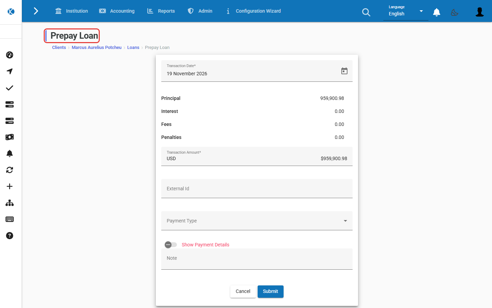
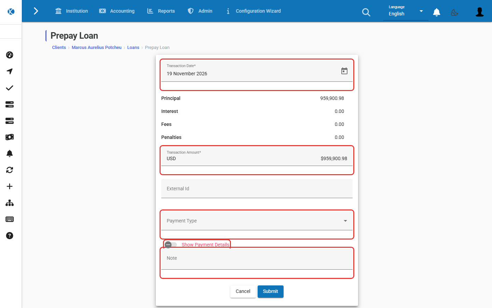

# Loan Payoff

## About payoff and prepayment

A pay-off is a repayment transaction that settles a borrower's loan obligations as of a specified date, with interest calculated as of that date. A prepayment is a pay-off that fully settles and closes an active loan account by paying the exact outstanding amount required as of the payoff date. Prepayment behaves similarly to a standard repayment transaction.

## Prepay a loan

Use this screen to fully settle and close an active loan account by paying the exact outstanding amount required as of a specified payoff date.

1. Select **Institution** > **Clients** and open the client.
2. Under **Loan Accounts**, select the loan account.
3. Open the **Loan Account Actions** menu (the ☰ button next to the account name).
4. Select **Prepay Loan**.
5. Open the **Prepay Loan** screen.

   

6. Enter the details described below, then select **Submit**.

| Field | Required | Description |
| --- | --- | --- |
| Transaction Date | Yes | Enter the date of the payoff transaction. Interest is calculated as of this date, and it cannot be in the future or earlier than the latest payment transaction date on the loan. |
| Transaction Amount | Yes | Enter the payoff amount. The system calculates the exact amount required to close the loan, including total outstanding principal, fees, and penalties as of the transaction date, and users cannot edit these calculated values. |
| Payment Type | No | Select the payment type for the prepayment transaction. |
| Show Payment Details | No | Show payment details for the transaction. |
| Account | No | Select the loan account to prepay. |
| Cheque | No | Enter cheque details if paying by cheque. |
| Routing Code | No | Enter the routing code for the payment. |
| Receipt | No | Enter the receipt number for the payment. |
| Bank | No | Select the bank for the payment. |
| Note | No | Enter a note for the prepayment transaction. |

The loan outstanding balance becomes zero, the loan status is marked as closed, and the amortization schedule is updated with the repayment payment.

## Eligibility and timing

You can pay off a loan as of any date from the last repayment date through the current business date. If interest recalculation is enabled, the same date range applies.

The payoff amount depends on the transaction date:

- If the transaction date is on or before the first disbursement date, you pay all principal and no interest on an interest-bearing loan product.
- If the transaction date is on or after the maturity date, you pay all outstanding balances.

The system rejects a prepayment transaction when:

- The prepayment date is in the future.
- The prepayment date is earlier than the latest repayment, prepayment, or payment transaction date on the loan.

## How to pay off or prepay

When you pay off or prepay a loan, the system calculates interest as of the pay-off date you enter and collects it as part of the payoff amount. The payoff amount equals total outstanding principal plus fees and penalties as of the transaction date.

## Interest recalculation options

Interest recalculation decides how much interest you pay when you pay off a loan early. It applies to pay-off transactions and changes how the system calculates the payable interest and modifies installments. The setting is enabled or disabled for the loan product.

| Interest recalculation | What you pay to fully pay off the loan |
| --- | --- |
| Disabled | Full principal, calculated interest, fees and any other charges; payable interest is the same whether pay-off happens mid-lifecycle or on the maturity date. |
| Enabled | Full principal and calculated interest only until the pay-off date; payable interest is only the recognized interest until that date. |

For progressive loans, interest recalculation works as follows:

- When interest recalculation is enabled, the system calculates payable interest until the pay-off date, modifies the current installment, and lifts interest from upcoming installments if the payment covers the outstanding principal on that installment.
- When interest recalculation is disabled, the pay-off amount is allocated across each installment instead of modifying the current period to reflect the full amount paid.

The pay-off calculation includes all outstanding balances calculated until the pay-off date or until the end of the pay-off period due date, based on configuration.

## Schedule and status changes

After payoff or prepayment, the amortization schedule is updated with the repayment payment, and repayments can be closed as fully paid or overpaid. The loan outstanding balance becomes zero, and the loan status is marked as closed.

## Accounting entries

A payoff transaction creates the same accounting entries as a repayment transaction.

## Balance and schedule updates

When you make a repayment, the system adjusts outstanding balances, updates the amortization schedule, and recalculates future periods.

## Overpayment and credit balance refund

When a loan account is overpaid, the system refunds the excess through a Credit Balance Refund (CBR) transaction. The refund reduces the credit balance and updates loan balances accordingly.

Rules for a Credit Balance Refund:

- The refund date cannot be before the smallest repayment transaction date.
- The overpayment amount is reduced by the refund amount.
- No amortization schedule recalculation is triggered.
- No delinquency or breach payment-application flow is triggered.

If the refund is backdated or reversed:

- On backdated execution, the system reprocesses subsequent transactions and recalculates balances and accounting entries.
- On reversal, the system recomputes balances accordingly.

## Backdated transactions and reversals

A backdated transaction or reversal of an older transaction triggers reverse replay of the loan account, and the system updates the loan status accordingly. When a payoff happens backdated, the system reverts accrual transactions that occurred after that date.

## User actions and undoing

You can pay off or prepay an active loan account from the user interface. You cannot edit the calculated payoff values; the system uses them as-is. You can undo the payoff or prepayment transaction from the transaction tab.

## Repayment application

When you make a repayment, the system applies the amount up to the outstanding obligation to that obligation. Any excess amount is recorded as an overpayment.

## Chargeback and disbursement on payoff loans

You can disburse funds on a pay-off loan account. Chargeback on a pay-off loan account is not allowed yet.

## Worked examples

A borrower takes a loan of 1,000 at an annual interest rate of 12 percent, to be repaid in two equal monthly installments. The office uses 30-day months and a 360-day year. The first installment is paid when due. Before the second installment falls due, the borrower asks to settle the loan early. The figures in this example are illustrative. With interest recalculation enabled, only the interest that has accrued up to the payoff date is collected; interest for the remaining period is not charged.

| Date | Transaction | Principal | Interest | Total | Balance |
| --- | --- | --- | --- | --- | --- |
| Jan 1 | Disbursement | - | - | - | 1,000.00 |
| Feb 1 | Installment 1 | 497.51 | 10.00 | 507.51 | 502.49 |
| Feb 15 | Payoff | 502.49 | 2.51 | 505.00 | 0.00 |

The same loan of 1,000 at 12 percent per year with two monthly installments reaches its final due date. The borrower does not pay the second installment on time and instead requests a payoff on or after the maturity date. Because no future installment remains, the full outstanding principal and all recognized interest are due. On or after the maturity date, all outstanding balances are payable and no future interest is lifted because there are no upcoming installments.

| Date | Transaction | Principal | Interest | Total | Balance |
| --- | --- | --- | --- | --- | --- |
| Jan 1 | Disbursement | - | - | - | 1,000.00 |
| Feb 1 | Installment 1 | 497.51 | 10.00 | 507.51 | 502.49 |
| Mar 1 | Payoff on maturity | 502.49 | 5.02 | 507.51 | 0.00 |

A borrower requests a payoff of 505.00 but pays 600.00. The payoff settles the loan in full, and the extra 95.00 is recorded as an overpayment. The office then refunds the excess to the borrower through a credit balance refund, bringing the credit balance back to zero. The loan schedule is not recalculated by the refund. Any amount paid above the payoff obligation is held as an overpayment and can be refunded to the borrower without changing the loan schedule.

| Item | Amount |
| --- | --- |
| Payoff amount due | 505.00 |
| Amount received | 600.00 |
| Overpayment recorded | 95.00 |
| Credit balance refund issued | 95.00 |
| Credit balance after refund | 0.00 |
