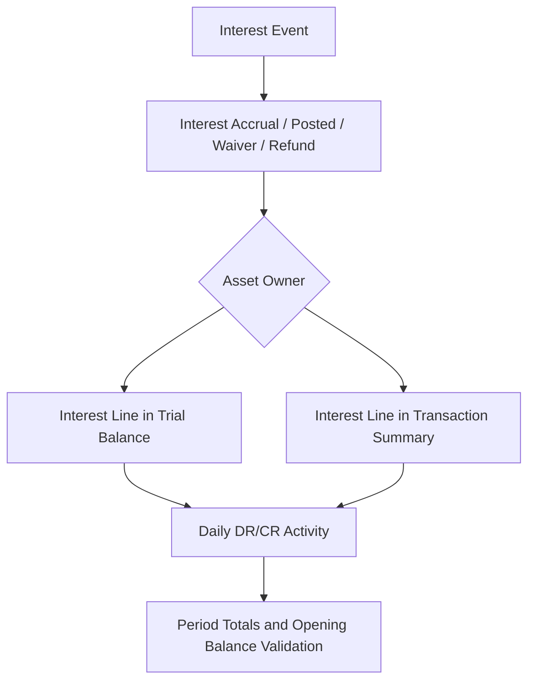

# Trial Balance report changes

This enhancement updates the Trial Balance and related reporting to reflect interest-related activity. Specifically, the report now includes interest accrual, interest posted, interest waiver, and interest refund within daily balances and daily DR/CR activity. In addition, the reports surface asset owner details and investor-level visibility for interest-related activity, supporting daily reconciliation and posting. The goal is to provide complete visibility of all interest-related movements and to verify correct asset owner attribution across trial balances and transaction summaries.

### What changed and why it matters

- Interest activity is now reflected in the Trial Balance and in daily DR/CR activity, including interest accruals, interest postings, waivers, and refunds. This verifies reconciliation can occur against all daily interest movements.
- New detail lines are created for interest installment products that show the correct asset owner details. This improves traceability and aligns interest activity with the standard asset owner in reports.
- Trial balance and transaction summary reports now reflect asset owner separation for interest-related activity and balances. This provides accurate attribution when multiple asset owners participate in interest-bearing products and when securitization or investor structures are involved.
- Interest activity by investor is available in daily accounting reports, enabling per-investor reconciliation and posting.

> Note: The changes focus on verified reporting behavior. Where the reference describes broader goals (such as securitization visibility), the reporting behavior presented here reflects the documented expectations for daily reconciliation and asset owner attribution as specified in the enhancement description.

### What changed in behavior (summary)

- The daily Trial Balance will include lines for the following interest events:
 - Interest accrual
 - Interest posted
 - Interest waiver
 - Interest refund
- New detail lines appear for interest installment products with correct asset owner details.
- Reports separate interest activity by asset owner , and also provide an investor-level view of interest activity.
- The Transaction Summary and Trial Balance are aligned to reflect asset owner separation for interest activity and balances.

### Updated workflow: generating and validating the Trial Balance with interest activity

1) Open the reporting workspace and navigate to Reporting and Accounting > Reports > Trial Balance report changes.
2) Select the date range associated to the period you are reconciling.
3) Run the Trial Balance report. The output includes standard balances plus new lines for:
 - Interest accrual
 - Interest posted
 - Interest waiver
 - Interest refund
4) Review the asset owner details on the new interest lines. Validate that the asset owner shown on each interest line matches the expected owner for that instrument.
5) If applicable, switch to the Transaction Summary view to confirm that interest-related activity reconciles with the trial balance lines, including investor-level breakdowns.
6) Perform standard reconciliation steps: verify opening balances against the previous period’s closing balances, verify DR/CR activity sums to reported changes, and confirm that remaining balances are consistent with expectations.
7) If any discrepancies arise, trace the relevant interest event through the source transactions to confirm the correct attribution and posting.

### Data interpretation and calculation notes

The report aggregates interest events into the daily trial balance and into daily DR/CR activity. For each interest event, the system records a associated line item in the Trial Balance, and the related balances reflect the impact of that event for the period. The interest events are shown under the same reporting framework as other transaction types and follow the standard rounding and precision rules used by the platform for daily postings. The exact accounting codes and chart of accounts assignments for interest events are defined by the system’s standard configuration and are not altered by this enhancement.

### Asset ownership and investor visibility

- New detail lines for interest installment products contain asset owner details to verify correct attribution.
- Trial Balance and Transaction Summary reports now reflect asset owner separation for interest activity and balances. This supports accurate reconciliation by asset owner and by investor when multiple structures (including securitization scenarios) are in play.
- The daily accounting view provides an investor-level breakdown of interest activity to support daily reconciliation and post-workflow processing.

### Migration considerations and operational implications

- Users should expect increased granularity in the Trial Balance and the Transaction Summary, with asset owner and investor-level detail appearing on interest-related lines.
- Training and revised reconciliation procedures may be required to incorporate the new interest lines into daily closing workflows.
- No data migration steps are described within the scope of this enhancement; the changes are implemented in how the reports present existing interest-related activity.
- Procedures for verifying opening balances, period totals, and allocations should be updated to include cross-checks of the new interest lines and asset owner details.

### Validation and integrity checks

- Opening balances for a period must match the closing balances from the previous period as reflected in related lines, including any interest-related movements.
- Interest-related DR/CR totals must reconcile with the associated lines in the Trial Balance and the Transaction Summary.
- Asset owner attribution on interest lines must be consistent between the Trial Balance and the Transaction Summary.
- Investor-level breakdowns must sum to the total interest activity shown in the period, and reconcile with the daily postings.

### Diagram: flow of interest activity into the Trial Balance

### Example structure (conceptual)

- Interest accrual line captures the pending interest that will be recognized as income or receivable in the period.
- Interest posted line captures actual movement when interest is received or settled.
- Interest waiver line captures reductions in owed interest when allowed by policy.
- Interest refund line captures reversal of previously charged interest due to overbilling or adjustment.
- Asset owner details appear on the associated lines to verify traceability to the originating instrument and owner.

This page documents the verified changes to the Trial Balance reporting as described in the enhancement specifications. It is intended to assist operations staff, loan officers, branch managers, and credit agents in understanding how interest-related activity now flows into daily reporting, how to access the updated views, and how to validate accuracy during daily reconciliation.