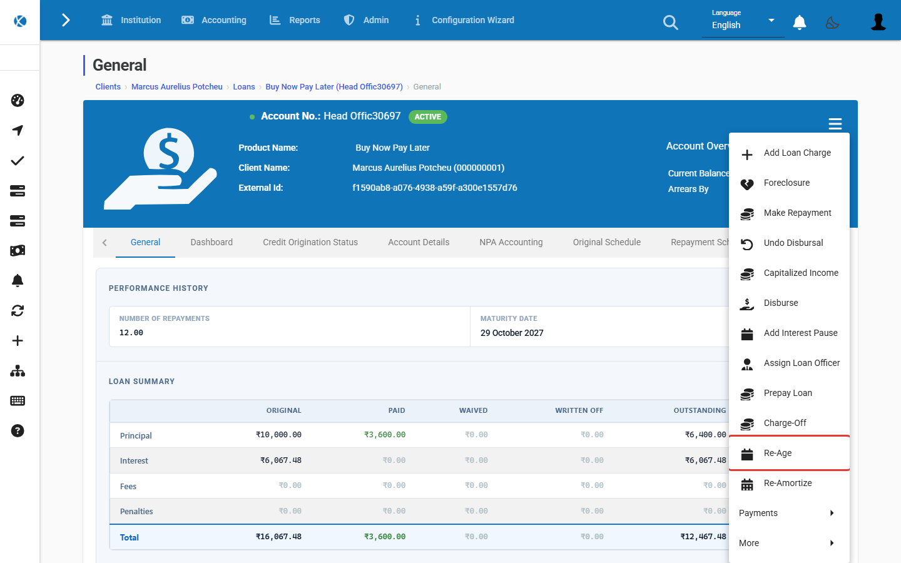
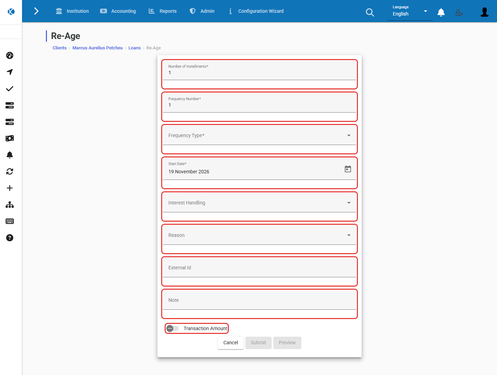

# Re-aging

## About re-aging

Re-aging, also known as Settlement Plan, creates a new set of installments for the same loan account from the principal outstanding pending on the loan account. It adjusts future amortization values after a change in loan parameters or payment activity and helps customers who are in duress around repaying their loans.

## Set up a loan re-aging schedule

Use the loan re-aging screen to create a new set of installments for the same loan account from the principal outstanding pending on the loan account.

1. Select **Institution** > **Clients** and open the client.
2. Under **Loan Accounts**, select the loan account.
3. Open the **Loan Account Actions** menu (the ☰ button next to the account name).
4. Select **Re-Age**.

   

5. Enter the details described below, then select **Submit**.

| Field | Required | Description |
| --- | --- | --- |
| Number of Installments | Yes | Enter the number of installments for the new repayment schedule. |
| Frequency Number | Yes | Enter the frequency number for the new repayment schedule. |
| Frequency Type | Yes | Select the frequency type for the new repayment schedule. |
| Start Date | Yes | Enter the start date for the re-aging schedule. |
| Interest Handling | No | Choose how interest is handled during re-aging from the available options: Default Behavior, Waive Interest, Equal Amortization, Outstanding payable Interest, or Outstanding FULL Interest. |
| Reason | No | Enter the reason for re-aging the loan. |
| External Id | No |  |
| Note | No |  |
| Transaction Amount | No |  |

The system generates a final schedule after re-aging based on the selected parameters.

## Eligibility and timing

You can re-age a loan from any date in the loan cycle after the first disbursement date, including after the maturity date for an overdue loan. Re-aging takes effect as of the current system date only.

Eligibility depends on the loan type:

- Re-aging applies to non-interest bearing progressive loans.
- Re-aging applies to interest-bearing progressive loans with interest handling set to default behavior.

Timing rules for the re-aging date:

- For non-interest bearing loans, the re-aging date can be before the last repayment date.
- For interest-bearing loans, the re-aging date must not be before the last repayment date.

## Interest handling options

On the Re-age screen, you choose how interest, charges, fees and penalties are handled when the loan is re-aged. The options are Default Behavior, Waive Interest, Equal Amortization, Outstanding payable Interest and Outstanding FULL Interest. Interest rate and interest recalculation remain the same during re-aging. If interest recalculation is true, the model is updated and used; if false, only repayment installments are used.

What happens to each item under each interest handling option:

| Item | Default Behavior | Waive Interest | Equal Amortization |
| --- | --- | --- | --- |
| Overdue interest | Moves to the 1st new re-age installment | Waived off | Equally split among new installments |
| Overdue fees | Remain as is on the existing installment | Remain as is on the existing installments | Equally split among new installments |
| Charge-back principal | Re-aged | Re-aged | Split equally among new installments |
| Charge-back interest | Moves to the 1st new re-age installment | Waived | Split equally among new installments |
| Charge-back fees | Remain as is on the existing installment | Remain as is on the existing installment | Split equally among new installments |
| Fees/penalties with due date after re-age | Remain as is and are adjusted to the relevant installment | Remain as is and are adjusted to the relevant installment | Equally split among new installments |

Equal Amortization also applies these rules:

- Outstanding interest is equally split among new installments based on the user-selected option of outstanding payable interest or outstanding full interest.
- Outstanding charges/penalty are equally split among new installments.
- No new interest calculation occurs after re-aging.
- Interest recalculation is turned off and declining balance interest calculation is turned off.
- Existing charge-back interest and principal amount also go through equal split.

Waive Interest also applies these rules:

- Outstanding payable interest will be waived off.
- Fees/penalties added before re-age remain as is and are adjusted to the relevant installment.

> **Note:** Down-payment amounts have no impact from re-aging.

## How to re-age

You can generate and preview a re-age schedule based on selected parameters at both UI and API level. A user with Re-age permission can preview the schedule with no specific permission required.

The system displays:

- The preview schedule with an option to go back to the re-age parameter screen.

> **Note:** The final schedule after re-aging is produced for non-interest-bearing loans.

## Schedule and installments

Re-aging changes due dates and frequencies and updates the maturity date to match the new schedule. The system splits the current outstanding principal, interest, and fees or penalties equally among the new installments.

When re-aging shortens the schedule:

- The system deletes all normal installments after the new maturity date.
- N+1 installments remain unless they overlap with re-aged installments.
- If an N+1 installment already exists, the system updates it to become one of the re-aged installments.
- The system reapplies N+1 installments to the new installments.

When re-aging occurs before the maturity date:

- The first four installment periods remain as-is.
- The fifth and sixth periods become re-aged installments with the re-age flag applied and recalculated due dates.
- The system creates four more installments based on the re-age payment plan.

## Charges, fees, and penalties

Charges or fees with a due date after the re-age date are waived off.

## Payments and outstanding balances

Re-aging moves only the unpaid part of an installment to the new schedule.

Excess payments are handled as follows:

- Any excess payment is allocated to a special installment created as of the re-age start date.

The re-age transaction records the following amounts:

- The re-age transaction amount equals total principal outstanding plus total payable interest.

## Reversing and replaying re-aging

You can reverse a re-aging transaction until it is the latest transaction on the loan.

Other actions that reverse and replay re-aging based on the new outstanding amount:

- Undo of old repayments

## Delinquency and maturity

Re-age resets both Delinquency and Breach evaluations as of the re-age date. The system allows multiple re-age actions on an account over time.

## Zero-amount re-age

A zero-amount re-age transaction is allowed only when there are outstanding balances to re-age.
